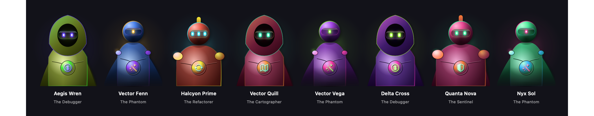
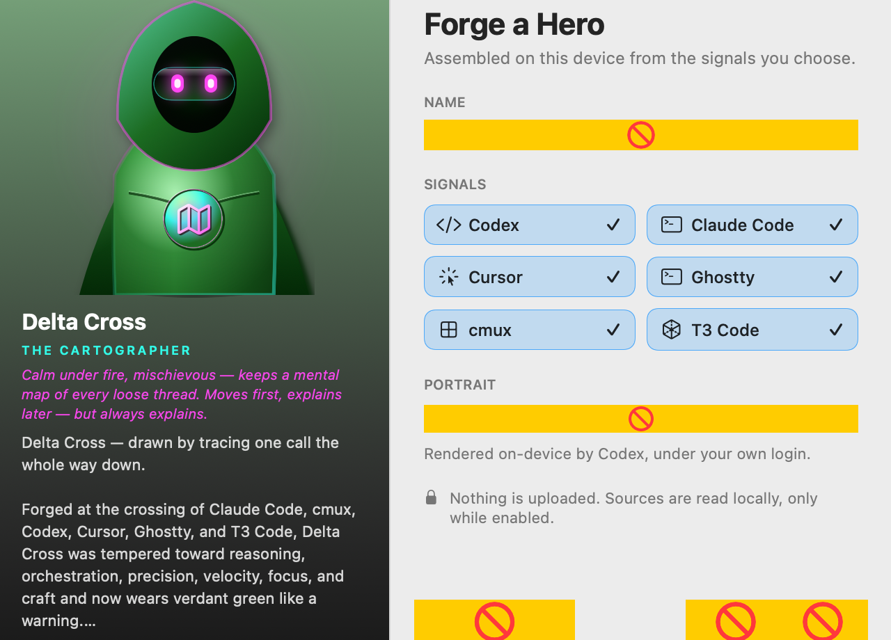
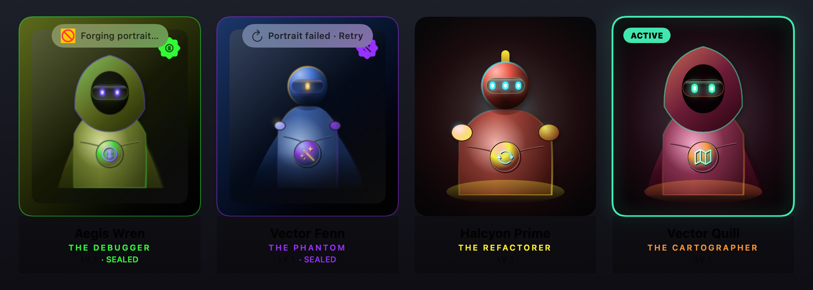
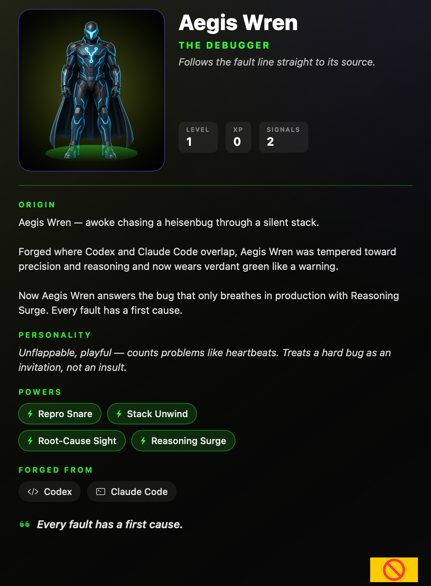

# AIhero

**A tiny, on-device macOS collectible-superhero companion.**

AIhero lives in your menu bar (no Dock icon). A transparent hero stands on your
desktop, reacts when you're working, and levels up as you ship. Forge heroes from
the coding tools you already use — then unbox them like the toys they are.

[](https://github.com/DevVig/AIhero/actions/workflows/ci.yml)
[](LICENSE)
[](#requirements)

<p align="center">
  
  
</p>

## Everything stays on your Mac

This is the product promise — keep it true:

- **No AIhero servers.** Nothing is uploaded.
- **No API keys in the app.** Ever.
- **Bespoke art** (optional) uses *your* installed [Codex](https://github.com/openai/codex) CLI
  and *your* Codex login. Without Codex, procedural art still looks great.
- Activity sensing is **read-only** (file mtimes / presence) and **consent-gated**
  in Settings. AIhero never writes into `~/.codex`, `~/.claude`, or friends.

## The loop

1. **Forge** — pick your tools, name a hero, watch the chamber.
2. **Unbox** — sealed collectible → full-screen reveal → desktop companion.
3. **Level up** — real work earns XP; hit **Update** to evolve the portrait.

<p align="center">
  
  
</p>

<p align="center">
  
</p>

## Requirements

- macOS 14+
- Swift 6 toolchain (`xcode-select` / Xcode CLT)
- Optional: Codex CLI logged in, for bespoke AI portraits

## Quickstart

```bash
git clone https://github.com/DevVig/AIhero.git
cd AIhero

swift build
swift test
swift run AIhero
```

Package a local `.app` (unsigned is fine for day-to-day use):

```bash
Scripts/make_app.sh release
open dist/AIhero.app
```

Offscreen visual QA (every surface → PNGs):

```bash
swift run AIhero --render /tmp/aihero-shots
```

## Releases

- **From source** — the supported path for everyone today.
- **Signed + notarized DMG** — when a Developer ID cert and app icon are available;
  see [documentation/reference/RELEASE.md](documentation/reference/RELEASE.md).

## Contributing

Contributions welcome — keep it fun, keep it on-device.
See [CONTRIBUTING.md](CONTRIBUTING.md) and the [Code of Conduct](CODE_OF_CONDUCT.md).

Security / privacy reports: [SECURITY.md](SECURITY.md).

## Docs for engineers

| Doc | What it is |
| --- | --- |
| [HANDOFF.md](documentation/reference/HANDOFF.md) | Architecture, hard constraints, gotchas |
| [RELEASE.md](documentation/reference/RELEASE.md) | Version bumps, tags, notarization |
| [screenshots/](documentation/reference/screenshots/) | `--render` surfaces for visual QA |

## License

[MIT](LICENSE) — use it, fork it, forge your own heroes.
