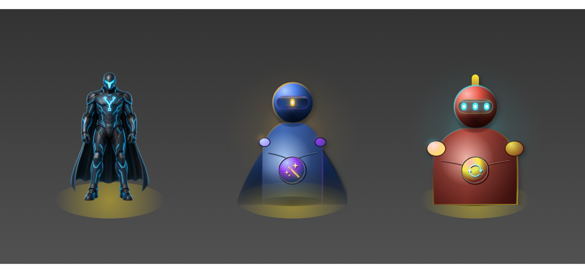
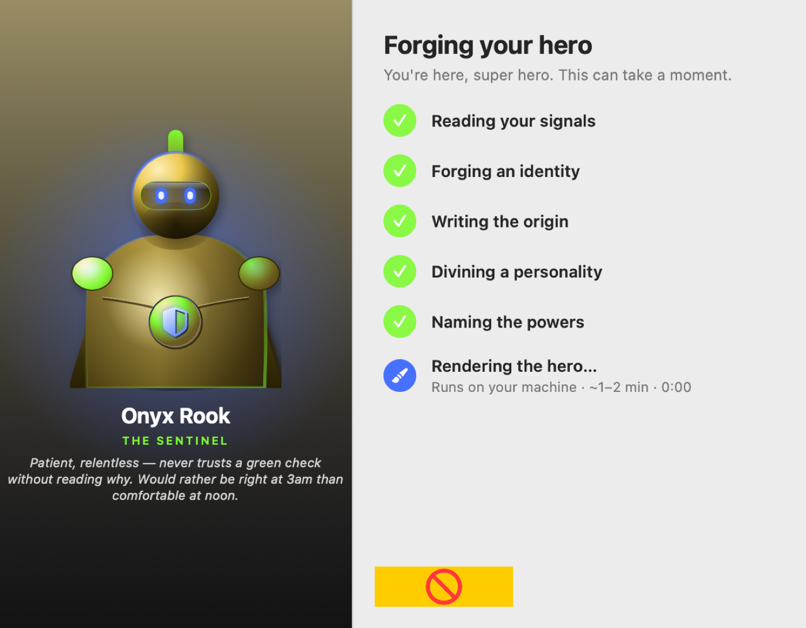
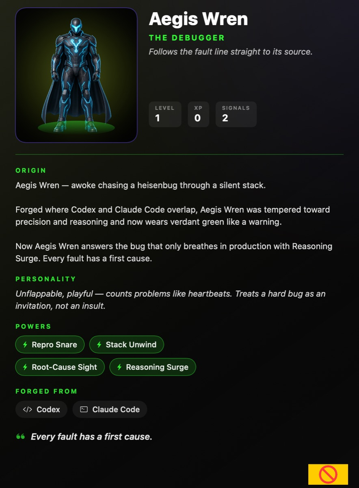

<p align="center">
  
</p>

<h1 align="center">AIhero</h1>

<p align="center">
  <strong>Forge collectible superheroes on your Mac.</strong><br />
  A tiny menu-bar companion that lives on your desktop, reacts when you work,<br />
  and levels up as you ship — all on-device, no Dock icon, no cloud.
</p>

<p align="center">
  <a href="https://github.com/DevVig/AIhero/actions/workflows/ci.yml"></a>
  <a href="LICENSE"></a>
  <a href="#requirements"></a>
  <a href="#requirements"></a>
  
</p>

<p align="center">
  <a href="#the-loop">The loop</a> ·
  <a href="#everything-stays-on-your-mac">Privacy</a> ·
  <a href="#quickstart">Quickstart</a> ·
  <a href="#project-layout">Layout</a> ·
  <a href="#contributing">Contributing</a>
</p>

---

## Meet the companion

A transparent hero stands on your desktop. The menu bar tracks whether you're
idle, thinking, working, or shipping. Open **My Heroes** to unbox sealed
figures, read dossiers, and evolve portraits as you earn XP.

<p align="center">
  
</p>

<p align="center">
  <em>Three companions on the desktop — procedural fallback art that still feels like a toy.</em>
</p>

---

## The loop

| Step | What happens |
| ---- | ------------ |
| **1. Forge** | Pick the tools you use (Codex, Claude Code, Cursor, Ghostty, cmux, T3 Code). Name your hero. Watch the chamber. |
| **2. Unbox** | A sealed collectible lands on the shelf → full-screen reveal → the hero settles on your desktop. |
| **3. Level up** | Real work earns XP. Hit **Update** to evolve the portrait — same genome, higher tier. |

<p align="center">
  
  &nbsp;
  
</p>

<p align="center">
  
</p>

<p align="center">
  <em>Chamber → sealed boxes → dossier. Fun first. Knobs last.</em>
</p>

---

## Everything stays on your Mac

This is the product promise — and a hard engineering rule:

| Promise | What it means |
| ------- | ------------- |
| **No AIhero servers** | Nothing is uploaded. There is no backend. |
| **No API keys in the app** | Ever. We will never ask you to paste one. |
| **Optional bespoke art** | Uses *your* installed [Codex](https://github.com/openai/codex) CLI under *your* login. No Codex? Procedural art still looks great. |
| **Read-only activity** | We may notice **file modification times** on tools you enable. We never open prompt text or source. |
| **Consent-gated** | Turn a source off in Settings → it is not read. |
| **No hook installs** | We never rewrite `~/.codex`, `~/.claude`, `~/.cursor`, or your shell rc. |

---

## Requirements

- **macOS 14+**
- **Swift 6** toolchain (Xcode 16 / Command Line Tools)
- **Optional:** Codex CLI, logged in — for AI-generated portraits

---

## Quickstart

```bash
git clone https://github.com/DevVig/AIhero.git
cd AIhero

swift build
swift test                 # 52 tests
swift run AIhero           # menu-bar ⚡ + desktop companion
```

### Package a local `.app`

```bash
Scripts/make_app.sh release
open dist/AIhero.app
```

Unsigned / ad-hoc is fine for daily use. For a signed + notarized DMG (Apple
Developer ID required), see [documentation/reference/RELEASE.md](documentation/reference/RELEASE.md).

### Visual QA

```bash
swift run AIhero --render /tmp/aihero-shots
open /tmp/aihero-shots
```

Curated README shots live in [`docs/images/`](docs/images/). Full offscreen
surfaces live in [`documentation/reference/screenshots/`](documentation/reference/screenshots/).

---

## Project layout

```text
Sources/AIhero/
  App/           Menu bar, windows, entry (`--render`, `--version`, signal CLI)
  Model/         Heroes, roster, XP / evolution, persistence
  Forge/         Deterministic forge + narrated chamber
  Art/           Procedural portraits & figures (fallback)
  Generation/    Codex harness probe + bespoke art pipeline
  Activity/      Read-only ambient signals + optional `aihero signal`
  Companion/     Transparent desktop panel
  Shelf/         My Heroes, boxes, dossier
  Settings/      Consent toggles, launch-at-login
  Reveal/        Full-screen unboxing burst
Scripts/         make_app · make_icon · sign_app · release
Tests/           52 unit tests
docs/images/     README visuals
documentation/   Plans, completed write-ups, engineer hand-off
```

Engineer deep-dive: **[documentation/reference/HANDOFF.md](documentation/reference/HANDOFF.md)**  
Hard constraints live there — read them before changing privacy-sensitive paths.

---

## Releases

| Path | Who it's for |
| ---- | ------------ |
| **From source** (`swift run` / `make_app.sh`) | Everyone today — fully supported |
| **Signed + notarized DMG** | Gatekeeper-clean installers — needs your Developer ID + icon PNG ([RELEASE.md](documentation/reference/RELEASE.md)) |

Current bundle version: **0.1.0**

---

## Contributing

Contributions welcome. Keep it **fun, not bloat**, and keep it **on-device**.

- [CONTRIBUTING.md](CONTRIBUTING.md) — build loop, privacy rules, doc lifecycle
- [CODE_OF_CONDUCT.md](CODE_OF_CONDUCT.md) — be kind
- [SECURITY.md](SECURITY.md) — private reports for privacy / security issues

PRs should stay green on CI (`swift build` + `swift test` on macOS 15 / Xcode 16).

---

## License

[MIT](LICENSE) — use it, fork it, forge your own heroes.
