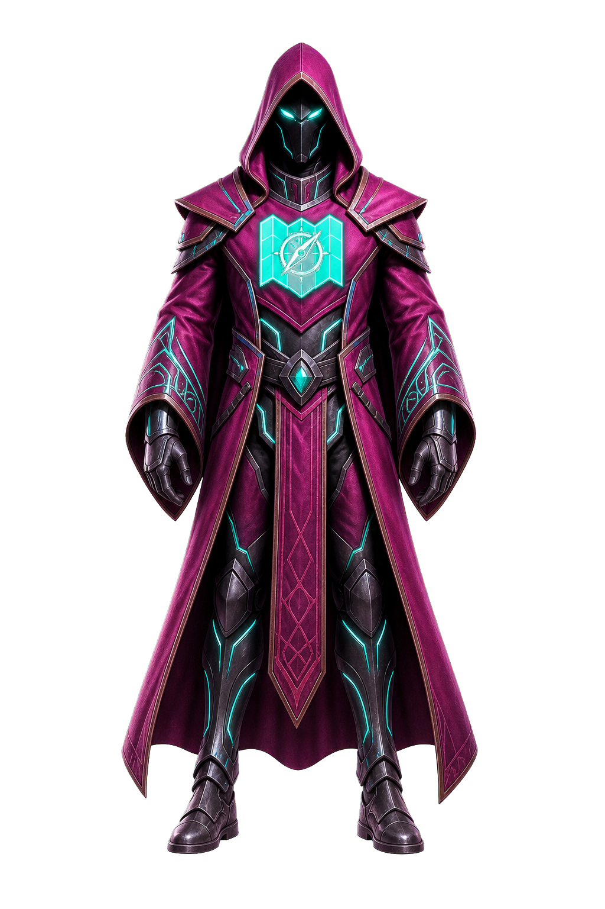
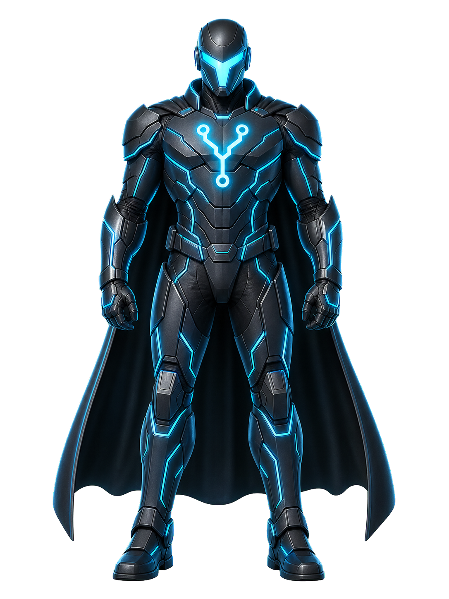

# AIhero

**On-device macOS collectible superhero companion.**

Forge a one-of-one hero from the coding tools you already use, unbox it onto your desktop, and let it react as you work — all on your Mac. No AIhero server. No API key to paste into the app.

<p align="center">
  
  &nbsp;&nbsp;
  
</p>

<p align="center">
  <em>Bespoke heroes, generated locally through your own Codex login — not a shipped art pack.</em>
</p>

---

## What it is

A tiny menu-bar companion (no Dock icon) with a clear collectible loop:

1. **Forge** a hero from consented local signals (Codex, Claude Code, Cursor, and friends)
2. **Unbox** it with a short cinematic burst
3. Keep a **transparent, draggable, scalable** figure on your desktop
4. Switch heroes from a **My Heroes** shelf
5. Earn XP as you work → hit **Update** to evolve and re-forge the portrait

Bespoke art is rendered by *your* installed Codex CLI under *your* login. If no image harness is available, the app falls back to built-in procedural art — no dead ends.

## Privacy promises

| Promise | How it's kept |
|---|---|
| Nothing leaves your Mac via AIhero | No AIhero backend; no shipped API key |
| Art uses *your* harness | Shells out to `codex exec` under your Codex login |
| Other tools are read-only | Ambient activity uses **mtime/presence only** — never prompt text or code |
| No hook injection | AIhero never writes into `~/.codex`, `~/.claude`, `~/.cursor`, or shell rc |
| Consent-gated | Every source is a Settings toggle |

## Quick start

**Requirements:** macOS 14+, Xcode / Swift 6 toolchain.

```bash
git clone https://github.com/DevVig/AIhero.git
cd AIhero
swift build
swift run AIhero          # menu-bar ⚡ appears; empty roster opens My Heroes
swift test                # currently 52 tests
```

Useful flags:

| Command | Purpose |
|---|---|
| `swift run AIhero --render /tmp/aihero-shots` | Offscreen visual QA → PNGs of every surface |
| `swift run AIhero --forge-test` | End-to-end bespoke art run (needs Codex logged in) |
| `swift run AIhero --version` | Print version |
| `swift run AIhero signal working --tool codex --cwd "$PWD"` | Optional activity ping |

Package a local `.app`:

```bash
Scripts/make_app.sh release   # → dist/AIhero.app
open dist/AIhero.app
```

Signed / notarized DMG (needs your Apple Developer ID):

```bash
DEVELOPER_ID_APP="Developer ID Application: Your Name (TEAMID)" \
  Scripts/release.sh path/to/icon.png
```

## Status

| Area | State |
|---|---|
| Collectible loop (forge → shelf → unbox → companion) | Done |
| Forging Chamber + personality / origin story | Done |
| Bespoke art via Codex (key-free) | Done |
| Read-only activity + manual Evolve / Update | Done |
| Packaging scripts (bundle / sign / notarize / DMG) | Scripts ready — **needs your cert + icon** |
| WorkState-driven sprite animation atlas | Planned (fast-follow) |
| Harness discovery brief (“really about you”) | Planned |
| Public signed DMG on Releases | **Not yet** |

**Full production checklist → [`PRODUCTION.md`](PRODUCTION.md)**  
**Engineer hand-off → [`documentation/reference/HANDOFF.md`](documentation/reference/HANDOFF.md)**

## Art directions

Style references (quality bar only — not shipped heroes):

| Direction | Reference |
|---|---|
| Ink / comic | `documentation/reference/hero-style-refs/debugger-inkComic.png` |
| Cinematic 3D | `documentation/reference/hero-style-refs/orchestrator-cinematic3D.png` |
| Chibi / toy | `documentation/reference/hero-style-refs/refactorer-chibiToy.png` |

## Repo map

```
Sources/AIhero/     native SwiftUI + AppKit app
Tests/AIheroTests/  unit + integration tests
Scripts/            make_app / make_icon / sign_app / release
documentation/      planned → active → completed → reference
```

## Contributing

This is an early product repo. Prefer small PRs against `main`. Before changing privacy-sensitive paths (activity readers, harness spawning, packaging), read the hard constraints in [`HANDOFF.md`](documentation/reference/HANDOFF.md).

```bash
swift build && swift test
```

## License

MIT — see [LICENSE](LICENSE).
